# Poly Haven: Abandoned & Ruins HDRIs

**61 assets from [Poly Haven](https://polyhaven.com), dedicated to the public domain under [CC0](https://polyhaven.com/license).** Use them in any game, free or paid, and change them however you like; no credit is needed.

HDRI skies and environments as 1K and 2K Radiance `.hdr` images, for lighting and backgrounds. 505.3 MB in all.

This is a copy kept by [zuujis-cc0](https://github.com/zuujis-cc0) so game makers can take single files from GitHub. It is not made by or affiliated with Poly Haven: the originals, in more formats and higher resolutions, are on [polyhaven.com](https://polyhaven.com). If they help you, consider [supporting Poly Haven](https://www.patreon.com/polyhaven/overview).

Every file is listed in [MANIFEST.tsv](MANIFEST.tsv) with its size and SHA-256. More free assets: [the collection](https://github.com/zuujis-cc0/free-game-assets#readme).

| | | | |
| :-: | :-: | :-: | :-: |
| <a href="abandoned_bakery">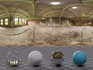</a> <b><a href="abandoned_bakery">Abandoned Bakery</a></b> by Sergej Majboroda · <a href="https://polyhaven.com/a/abandoned_bakery">source</a> | <a href="abandoned_church">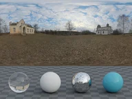</a> <b><a href="abandoned_church">Abandoned Church</a></b> by Sergej Majboroda · <a href="https://polyhaven.com/a/abandoned_church">source</a> | <a href="abandoned_construction">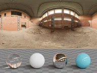</a> <b><a href="abandoned_construction">Abandoned Construction</a></b> by Sergej Majboroda · <a href="https://polyhaven.com/a/abandoned_construction">source</a> | <a href="abandoned_factory_canteen_01">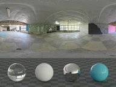</a> <b><a href="abandoned_factory_canteen_01">Abandoned Factory Canteen 01</a></b> by Sergej Majboroda · <a href="https://polyhaven.com/a/abandoned_factory_canteen_01">source</a> |
| <a href="abandoned_factory_canteen_02">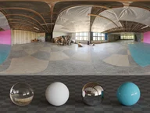</a> <b><a href="abandoned_factory_canteen_02">Abandoned Factory Canteen 02</a></b> by Sergej Majboroda · <a href="https://polyhaven.com/a/abandoned_factory_canteen_02">source</a> | <a href="abandoned_games_room_01">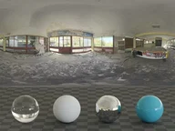</a> <b><a href="abandoned_games_room_01">Abandoned Games Room 01</a></b> by Octavian Tudose · <a href="https://polyhaven.com/a/abandoned_games_room_01">source</a> | <a href="abandoned_games_room_02">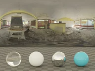</a> <b><a href="abandoned_games_room_02">Abandoned Games Room 02</a></b> by Octavian Tudose · <a href="https://polyhaven.com/a/abandoned_games_room_02">source</a> | <a href="abandoned_garage">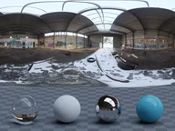</a> <b><a href="abandoned_garage">Abandoned Garage</a></b> by Grzegorz Wronkowski · <a href="https://polyhaven.com/a/abandoned_garage">source</a> |
| <a href="abandoned_greenhouse">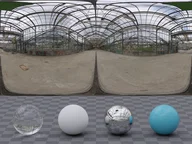</a> <b><a href="abandoned_greenhouse">Abandoned Greenhouse</a></b> by Andreas Mischok · <a href="https://polyhaven.com/a/abandoned_greenhouse">source</a> | <a href="abandoned_hall_01">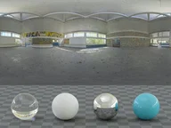</a> <b><a href="abandoned_hall_01">Abandoned Hall 01</a></b> by Octavian Tudose · <a href="https://polyhaven.com/a/abandoned_hall_01">source</a> | <a href="abandoned_hopper_terminal_01">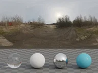</a> <b><a href="abandoned_hopper_terminal_01">Abandoned Hopper Terminal 01</a></b> by Sergej Majboroda · <a href="https://polyhaven.com/a/abandoned_hopper_terminal_01">source</a> | <a href="abandoned_hopper_terminal_02">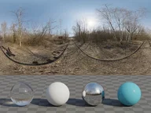</a> <b><a href="abandoned_hopper_terminal_02">Abandoned Hopper Terminal 02</a></b> by Sergej Majboroda · <a href="https://polyhaven.com/a/abandoned_hopper_terminal_02">source</a> |
| <a href="abandoned_hopper_terminal_03">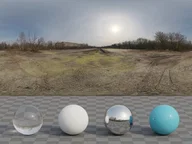</a> <b><a href="abandoned_hopper_terminal_03">Abandoned Hopper Terminal 03</a></b> by Sergej Majboroda · <a href="https://polyhaven.com/a/abandoned_hopper_terminal_03">source</a> | <a href="abandoned_hopper_terminal_04">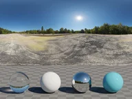</a> <b><a href="abandoned_hopper_terminal_04">Abandoned Hopper Terminal 04</a></b> by Sergej Majboroda · <a href="https://polyhaven.com/a/abandoned_hopper_terminal_04">source</a> | <a href="abandoned_slipway">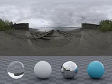</a> <b><a href="abandoned_slipway">Abandoned Slipway</a></b> by Philip Modin · <a href="https://polyhaven.com/a/abandoned_slipway">source</a> | <a href="abandoned_tank_farm_01">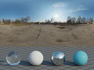</a> <b><a href="abandoned_tank_farm_01">Abandoned Tank Farm 01</a></b> by Sergej Majboroda · <a href="https://polyhaven.com/a/abandoned_tank_farm_01">source</a> |
| <a href="abandoned_tank_farm_02">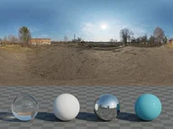</a> <b><a href="abandoned_tank_farm_02">Abandoned Tank Farm 02</a></b> by Sergej Majboroda · <a href="https://polyhaven.com/a/abandoned_tank_farm_02">source</a> | <a href="abandoned_tank_farm_03">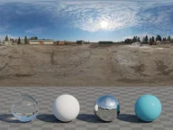</a> <b><a href="abandoned_tank_farm_03">Abandoned Tank Farm 03</a></b> by Sergej Majboroda · <a href="https://polyhaven.com/a/abandoned_tank_farm_03">source</a> | <a href="abandoned_tank_farm_05">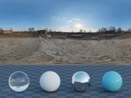</a> <b><a href="abandoned_tank_farm_05">Abandoned Tank Farm 05</a></b> by Sergej Majboroda · <a href="https://polyhaven.com/a/abandoned_tank_farm_05">source</a> | <a href="abandoned_tiled_room">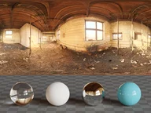</a> <b><a href="abandoned_tiled_room">Abandoned Tiled Room</a></b> by Sergej Majboroda · <a href="https://polyhaven.com/a/abandoned_tiled_room">source</a> |
| <a href="abandoned_waterworks">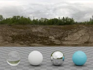</a> <b><a href="abandoned_waterworks">Abandoned Waterworks</a></b> by Sergej Majboroda · <a href="https://polyhaven.com/a/abandoned_waterworks">source</a> | <a href="abandoned_workshop">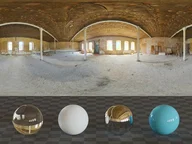</a> <b><a href="abandoned_workshop">Abandoned workshop</a></b> by Sergej Majboroda · <a href="https://polyhaven.com/a/abandoned_workshop">source</a> | <a href="abandoned_workshop_02">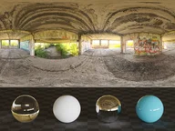</a> <b><a href="abandoned_workshop_02">Abandoned Workshop 02</a></b> by Sergej Majboroda · <a href="https://polyhaven.com/a/abandoned_workshop_02">source</a> | <a href="brick_factory_01">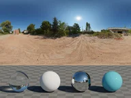</a> <b><a href="brick_factory_01">Brick Factory 01</a></b> by Sergej Majboroda · <a href="https://polyhaven.com/a/brick_factory_01">source</a> |
| <a href="burnt_warehouse">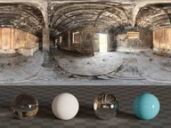</a> <b><a href="burnt_warehouse">Burnt Warehouse</a></b> by Sergej Majboroda · <a href="https://polyhaven.com/a/burnt_warehouse">source</a> | <a href="creepy_bathroom">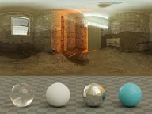</a> <b><a href="creepy_bathroom">Creepy Bathroom</a></b> by Greg Zaal · <a href="https://polyhaven.com/a/creepy_bathroom">source</a> | <a href="debris_basement_corridor">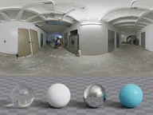</a> <b><a href="debris_basement_corridor">Debris Basement Corridor</a></b> by Elvis Posa · <a href="https://polyhaven.com/a/debris_basement_corridor">source</a> |  <b><a href="derelict_airfield_01">Derelict Airfield 01</a></b> by Alexander Scholten · <a href="https://polyhaven.com/a/derelict_airfield_01">source</a> |
| <a href="derelict_airfield_02">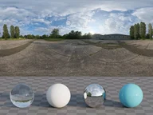</a> <b><a href="derelict_airfield_02">Derelict Airfield 02</a></b> by Alexander Scholten · <a href="https://polyhaven.com/a/derelict_airfield_02">source</a> | <a href="distribution_board">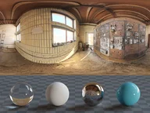</a> <b><a href="distribution_board">Distribution Board</a></b> by Sergej Majboroda · <a href="https://polyhaven.com/a/distribution_board">source</a> | <a href="empty_warehouse_01">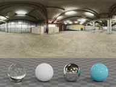</a> <b><a href="empty_warehouse_01">Empty Warehouse 01</a></b> by Sergej Majboroda · <a href="https://polyhaven.com/a/empty_warehouse_01">source</a> | <a href="gothic_manor_01">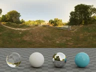</a> <b><a href="gothic_manor_01">Gothic Manor 01</a></b> by Sergej Majboroda · <a href="https://polyhaven.com/a/gothic_manor_01">source</a> |
| <a href="gothic_manor_02">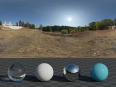</a> <b><a href="gothic_manor_02">Gothic Manor 02</a></b> by Sergej Majboroda · <a href="https://polyhaven.com/a/gothic_manor_02">source</a> | <a href="industrial_wooden_attic">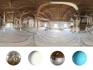</a> <b><a href="industrial_wooden_attic">Industrial Wooden Attic</a></b> by Grzegorz Wronkowski · <a href="https://polyhaven.com/a/industrial_wooden_attic">source</a> | <a href="mirrored_hall">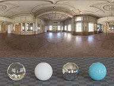</a> <b><a href="mirrored_hall">Mirrored Hall</a></b> by Grzegorz Wronkowski · <a href="https://polyhaven.com/a/mirrored_hall">source</a> | <a href="missile_launch_facility_01">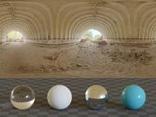</a> <b><a href="missile_launch_facility_01">Missile Launch Facility 01</a></b> by Sergej Majboroda · <a href="https://polyhaven.com/a/missile_launch_facility_01">source</a> |
| <a href="monkstown_castle">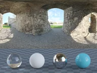</a> <b><a href="monkstown_castle">Monkstown Castle</a></b> by Savva Zakharov · <a href="https://polyhaven.com/a/monkstown_castle">source</a> | <a href="old_apartments_walkway">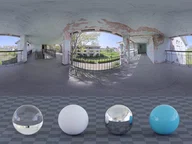</a> <b><a href="old_apartments_walkway">Old Apartments Walkway</a></b> by Octavian Tudose · <a href="https://polyhaven.com/a/old_apartments_walkway">source</a> | <a href="old_bus_depot">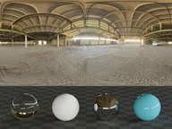</a> <b><a href="old_bus_depot">Old Bus Depot</a></b> by Sergej Majboroda · <a href="https://polyhaven.com/a/old_bus_depot">source</a> | <a href="old_depot">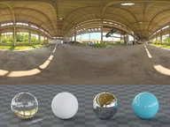</a> <b><a href="old_depot">Old Depot</a></b> by Sergej Majboroda · <a href="https://polyhaven.com/a/old_depot">source</a> |
| <a href="old_hall">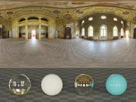</a> <b><a href="old_hall">Old Hall</a></b> by Sergej Majboroda · <a href="https://polyhaven.com/a/old_hall">source</a> | <a href="old_quarry_gerlingen">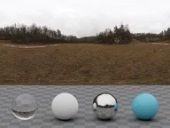</a> <b><a href="old_quarry_gerlingen">Old Quarry Gerlingen</a></b> by Andreas Mischok · <a href="https://polyhaven.com/a/old_quarry_gerlingen">source</a> | <a href="old_room">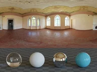</a> <b><a href="old_room">Old Room</a></b> by Sergej Majboroda · <a href="https://polyhaven.com/a/old_room">source</a> | <a href="peppermint_powerplant">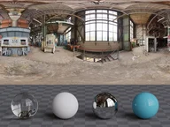</a> <b><a href="peppermint_powerplant">Peppermint Powerplant</a></b> by Andreas Mischok · <a href="https://polyhaven.com/a/peppermint_powerplant">source</a> |
| <a href="peppermint_powerplant_2">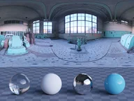</a> <b><a href="peppermint_powerplant_2">Peppermint Powerplant 2</a></b> by Andreas Mischok · <a href="https://polyhaven.com/a/peppermint_powerplant_2">source</a> | <a href="pump_station">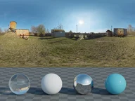</a> <b><a href="pump_station">Pump Station</a></b> by Sergej Majboroda · <a href="https://polyhaven.com/a/pump_station">source</a> | <a href="pylons">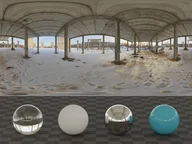</a> <b><a href="pylons">Pylons</a></b> by Sergej Majboroda · <a href="https://polyhaven.com/a/pylons">source</a> | <a href="reinforced_concrete_01">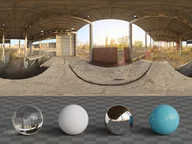</a> <b><a href="reinforced_concrete_01">Reinforced Concrete 01</a></b> by Sergej Majboroda · <a href="https://polyhaven.com/a/reinforced_concrete_01">source</a> |
| <a href="reinforced_concrete_02">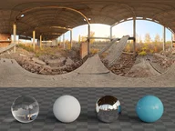</a> <b><a href="reinforced_concrete_02">Reinforced Concrete 02</a></b> by Sergej Majboroda · <a href="https://polyhaven.com/a/reinforced_concrete_02">source</a> | <a href="roofless_ruins">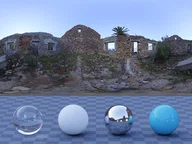</a> <b><a href="roofless_ruins">Roofless Ruins</a></b> by Greg Zaal, Rico Cilliers · <a href="https://polyhaven.com/a/roofless_ruins">source</a> | <a href="smelting_tower_01">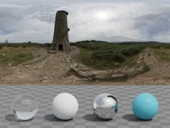</a> <b><a href="smelting_tower_01">Smelting Tower 01</a></b> by Savva Zakharov · <a href="https://polyhaven.com/a/smelting_tower_01">source</a> |  <b><a href="smelting_tower_02">Smelting Tower 02</a></b> by Savva Zakharov · <a href="https://polyhaven.com/a/smelting_tower_02">source</a> |
|  <b><a href="smelting_tower_interior">Smelting Tower Interior</a></b> by Savva Zakharov · <a href="https://polyhaven.com/a/smelting_tower_interior">source</a> |  <b><a href="summer_stage_01">Summer Stage 01</a></b> by Sergej Majboroda · <a href="https://polyhaven.com/a/summer_stage_01">source</a> |  <b><a href="summer_stage_02">Summer Stage 02</a></b> by Sergej Majboroda · <a href="https://polyhaven.com/a/summer_stage_02">source</a> |  <b><a href="teufelsberg_ground_1">Teufelsberg Ground 1</a></b> by Greg Zaal · <a href="https://polyhaven.com/a/teufelsberg_ground_1">source</a> |
|  <b><a href="teufelsberg_ground_2">Teufelsberg Ground 2</a></b> by Greg Zaal · <a href="https://polyhaven.com/a/teufelsberg_ground_2">source</a> |  <b><a href="teufelsberg_inner">Teufelsberg Inner</a></b> by Greg Zaal · <a href="https://polyhaven.com/a/teufelsberg_inner">source</a> |  <b><a href="teufelsberg_lookout">Teufelsberg Lookout</a></b> by Greg Zaal · <a href="https://polyhaven.com/a/teufelsberg_lookout">source</a> |  <b><a href="teufelsberg_roof">Teufelsberg Roof</a></b> by Greg Zaal · <a href="https://polyhaven.com/a/teufelsberg_roof">source</a> |
|  <b><a href="zavelstein">Zavelstein</a></b> by Andreas Mischok · <a href="https://polyhaven.com/a/zavelstein">source</a> |  |  |  |

---

Updated automatically by [cc0-mirror](https://github.com/zuujis-cc0/cc0-mirror). Something wrong? [Open an issue there](https://github.com/zuujis-cc0/cc0-mirror/issues/new) or use the [private report form](https://games.zuujis.com/report).
